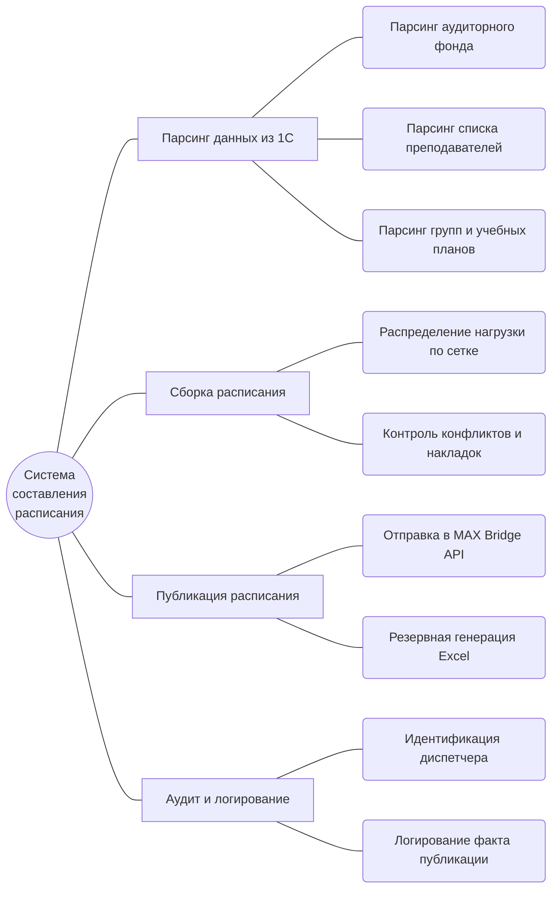

# Документ о концепции и границах кейса

| Поле | Значение |
|------|----------|
| Кейс | _название варианта_ |
| Индустриальный партнер | _организация / подразделение_ |
| Версия | `0.1-draft` |
| Дата | ГГГГ-ММ-ДД |
| Статус | черновик / на ревью / согласовано |
| Авторы | |

> [!NOTE]
> Заполняйте документ на языке заказчика. Образец глубины проработки — [`example/case_concept.md`](../example/case_concept.md). Колонки ID в таблицах шаблона — подсказка структуры, а не обязательная схема нумерации.

## 1. Введение

Краткая выжимка сути кейса: для кого система, какую проблему закрывает и чем отличается от текущего способа работы.

## 2. Бизнес-контекст и цели

### 2.1. Исходные данные

Как процесс устроен сейчас, какие потери времени / денег / качества наблюдаются, на каких фактах это основано.

### 2.2. Возможности бизнеса

Что изменится, если решение появится; какие смежные возможности откроются позже.

### 2.3. Бизнес-цели

| ID | Цель | Масштаб | Способ измерения | База | План | Обязательный порог | Срок |
|----|------|---------|------------------|------|------|--------------------|------|
| BO-1 | | | | | | | |
| BO-2 | | | | | | | |
| BO-3 | | | | | | | |

### 2.4. Видение решения

Одно-два предложения в формате: *для [пользователь], который [потребность], [имя системы] — это [тип продукта], который [ключевые возможности]. В отличие от [альтернатива], решение [отличие]*.

## 3. Бизнес-контекст и стейкхолдеры

### 3.1 Профили заинтересованных лиц

| Стейкхолдер | Описание и роль в проекте | Главная ценность от системы |
| :--- | :--- | :--- |
| **Учебное управление (Заказчик)** | Инициатор проекта. | Исключение ручного ввода, прозрачный аудит действий. |
| **Диспетчер расписания** | Основной пользователь АРМ. Авторизованный сотрудник, который формирует сетку и несет ответственность за её публикацию. | Удобный интерфейс распределения нагрузки на основе распарсенных данных из 1С. Контроль конфликтов. |
| **Администраторы MAX Bridge API** | Принимающая сторона (Out-bound). | Получение валидного JSON-массива с расписанием строго по спецификации API, без спама ошибочными запросами. |
| **ИТ-отдел университета** | Сторона-источник данных (In-bound). | Соблюдение правил транспорта (таймауты) при парсинге HTTP-сервисов 1С. |
| **Студенты и Преподаватели** | Косвенные потребители (Out of Scope). | Своевременное получение расписания (взаимодействуют напрямую с экосистемой MAX, а не с нашим АРМ). |

### 3.2 Матрица влияния / интереса

| Стейкхолдер | Влияние | Интерес | Стратегия взаимодействия |
| :--- | :--- | :--- | :--- |
| Учебное управление | Высокое | Высокий | **Плотно взаимодействовать**. Согласовывать логику авторизации публикации. |
| ИТ-отдел университета | Высокое | Низкий | **Удовлетворять потребности**. |
| Администраторы MAX Bridge API | Высокое | Средний | **Удовлетворять потребности**. Следить за изменениями в их спецификации (Swagger). |
| Диспетчер расписания | Низкое | Высокий | **Информировать и вовлекать**. |

## 4. Функциональные требования

### 4.1. Основные функции

| ID | Функция | Краткое описание |
|----|---------|------------------|
| FE-1 | | |
| FE-2 | | |

### 4.2. Дерево функций

### 4.3. Пользовательские истории / варианты использования

|ID| Основное действующее лицо | Варианты использования |
|---------------------------|------------------------|------------------------|
| US-1 | Диспетчер | Как Диспетчер, я хочу, чтобы система сама парсила актуальные списки групп и преподавателей из 1С, чтобы мне не приходилось вводить их вручную.|
| US-2 | Диспетчер | Как Диспетчер, я хочу видеть подсвеченные конфликты (например, если аудитория уже занята), чтобы не отправить ошибочное расписание.|
| US-3 | Учебное управление | Как Учебное управление, я хочу, чтобы система фиксировала ФИО пользователя, отправившего расписание в MAX Bridge API, чтобы понимать, кто авторизовал публикацию.|
| US-4 | Диспетчер | Как Диспетчер, я хочу иметь возможность выгрузить расписание в Excel, чтобы передать его вручную, если MAX Bridge API временно недоступен.|

### 4.4. Детальный сценарий (UC-1, UC-2)

#### UC-1. Формирование и авторизованная публикация расписания

| Поле | Значение |
|------|----------|
| Автор / дата | Аналитик команды 2 / 2026-10-08 |
| Основное действующее лицо | Диспетчер расписания (Авторизованный пользователь) |
| Дополнительные действующие лица | ИТ-система 1С, MAX Bridge API |
| Описание | Диспетчер формирует сетку на основе распарсенных данных и отправляет её в MAX Bridge API под своей учетной записью. |
| Условие-триггер | Диспетчер инициирует публикацию расписания в мессенджер. |
| Предварительные условия | PRE-1. Справочники успешно распарсены из 1С. PRE-2. Диспетчер авторизован в системе. |
| Выходные условия | POST-1. Данные отправлены в MAX Bridge API. POST-2. В системном логе зафиксировано, кто авторизовал отправку. |
| Приоритет | Высокий |
| Бизнес-правила | BR-1. Преподаватель не может вести два занятия одновременно. **BR-2. Аудитория не может быть занята разными группами одновременно (кроме потоковых лекций).** |

**Нормальное направление**

1. Диспетчер выбирает учебную группу в интерфейсе.
2. Система подтягивает распарсенные из 1С данные о дисциплинах.
3. Диспетчер распределяет занятия по времени, выбирая преподавателя и аудиторию.
4. Система проверяет конфликты (согласно BR-1 и BR-2).
5. Диспетчер нажимает кнопку "Опубликовать".
6. Система запрашивает подтверждение действия, отображая текущую учетную запись диспетчера (авторизация публикации).
7. Диспетчер подтверждает отправку.
8. Система записывает ФИО сотрудника и время действия в журнал аудита.
9. Система формирует JSON и отправляет POST-запрос в MAX Bridge API.
10. Система уведомляет об успешной публикации.

**Исключения**

- 9.0.E1. *MAX Bridge API недоступен:* Система логирует ошибку связи. Происходит локальное сохранение статуса без разрушения готовой сетки расписания ("гарантийно слома нет"). Система предлагает диспетчеру выполнить резервный экспорт в Excel.

 #### UC-2. Синхронизация справочников и учебных планов из 1С:Университет ПРОФ

| Поле | Значение |
|------|----------|
| Автор / дата | Аналитик команды 2 / 2026-10-08 |
| Основное действующее лицо | Диспетчер расписания |
| Дополнительные действующие лица | ИТ-система 1С:Университет ПРОФ |
| Описание | Загрузка актуальных данных о подразделениях, аудиториях, преподавателях, группах и учебных планах из корпоративной системы 1С для обеспечения АРМ Диспетчера исходными данными. |
| Условие-триггер | Диспетчер нажимает кнопку «Синхронизировать с 1С» перед началом составления расписания. |
| Предварительные условия | PRE-1. В настройках системы корректно заданы URL-адреса HTTP-сервисов 1С, логин и пароль для Basic-авторизации. PRE-2. Сервер 1С доступен в корпоративной сети. |
| Выходные условия | POST-1. Внутренняя база данных приложения обновлена актуальными записями из 1С. |
| Приоритет | Высокий (Критический функционал) |
| Частота использования | Средняя (1-2 раза в день вручную, либо автоматически каждую ночь). |
| Бизнес-правила | BR-3. Ранее загруженные данные, уже задействованные в готовом расписании, не удаляются физически при их пропаже из 1С (применяется логическое удаление/архивация), чтобы не сломать сетку занятий. |

**Нормальное направление**

1. Диспетчер открывает раздел "Справочники и интеграции" и нажимает кнопку "Запустить синхронизацию".
2. Система последовательно отправляет HTTP GET-запросы к согласованным эндпоинтам 1С (`Department_University`, `employees_v1`, `study_groups`, `list_curricula`).
3. Система 1С обрабатывает запросы и возвращает ответы в формате JSON.
4. Система валидирует полученные файлы (отрезает служебные префиксы до первой `{` или `[`, проверяет структуру).
5. Система обновляет справочники в своей локальной базе данных (добавляет новые сущности, обновляет изменившиеся атрибуты).
6. Система выводит диспетчеру уведомление: "Синхронизация завершена успешно. Загружено/обновлено: [Количество] записей".

**Альтернативные направления**

- 1.1. *Фоновая синхронизация по расписанию:* Вместо ручного запуска диспетчером, система автоматически инициирует шаги 2–5 по заданному таймеру (например, каждую ночь в 03:00). Шаг 6 заменяется на запись результатов в системный лог.
- 2.1. *Точечная загрузка дисциплин:* Для получения нагрузки (`disciplines_departments`) система берет полученные номера планов (`plan_number`) и делает отдельный GET-запрос на каждый номер плана.

**Исключения**

- 3.0.E1. *Превышение таймаута:* Система 1С не отвечает в течение установленного лимита (1800 с для тяжелых справочников, 600 с для легких). Процесс прерывается для текущего справочника. Система сохраняет старые данные и выводит диспетчеру ошибку таймаута.
- 4.0.E1. *Некорректный формат ответа:* Система 1С возвращает ответ с признаком `"error": true` или JSON с нарушенной структурой (пустой список там, где ожидается массив). Система логирует ошибку парсинга и пропускает обновление поврежденного справочника, уведомляя об этом пользователя.

**Другая информация**

- Размер получаемого файла может достигать 2 ГБ, а разбор в памяти ограничен 400 МБ. Система должна использовать потоковое чтение JSON (Stream API) при разборе объемных массивов (например, сотрудников).

**Предположения**

- Предполагается, что ИТ-отдел не меняет структуру JSON-ответов без предварительного уведомления команды разработки.

### 4.5 Сжатые Use Cases (UC-3, UC-4)

* **UC-3: Аудит авторизаций (Просмотр логов).** Представитель Учебного управления открывает системный журнал. Система выводит таблицу с историей публикаций: дата, ФИО диспетчера, факультет, статус отправки в MAX Bridge API.
* **UC-4: Резервный экспорт в Excel.** В случае падения внешних шлюзов, диспетчер нажимает "Экспорт". Система генерирует `.xlsx` файл строго по предоставленному шаблону МАХ для альтернативной передачи.

## 5. Нефункциональные требования (NFR)

| ID | Категория | Требование | Метрика / порог |
|----|-----------|------------|-----------------|
| NFR-P1 | Производительность | Система должна успешно парсить в оперативной памяти JSON-ответы от API 1С | Максимальный объем - 400 МБ |
| NFR-P2 | Производительность | Система должна поддерживать скачивание объёмных выгрузок из 1С во временное хранилище | Максимальный размер файла - 2 ГБ |
| NFR-A1 | Доступность и Надежность | Система должна поддерживать длительное ожидание ответа при запросе к тяжелым узлам 1С (например, `Department_University`, `employees_v1`) | Таймаут - 1800 секунд |
| NFR-A2 | Доступность и Надежность | Система должна обрывать зависшие запросы к легким справочникам 1С (например, `study_groups`, `list_curricula`) | Таймаут - 600 секунд |
| NFR-A3 | Доступность и Надежность | При обрывах связи с 1С или MAX Bridge API система не разрушает уже сформированную сетку занятий ("гарантийно слома нет") | 0% потерь локальных данных при таймаутах |
| NFR-S1 | Безопасность | Взаимодействие с API 1С должно происходить с использованием Basic-авторизации, пароли не хранятся в открытом виде | Наличие заголовка `Authorization: Basic` |
| NFR-S2 | Безопасность | Отправка данных должна осуществляться исключительно по защищенному каналу MAX Bridge API | Использование API-токена от МАХ |
| NFR-S3 | Безопасность (Аудит) | Идентификация автора: все попытки публикации расписания жестко привязываются к учетной записи диспетчера, который их авторизовал | 100% покрытие логами операций экспорта |
| NFR-C1 | Совместимость / IT-ландшафт | Система должна уметь отсекать произвольный неформатированный текст в ответах 1С, находя начало JSON (до первого знака `{` или `[`) | 100% успешный парсинг "грязных" ответов |
| NFR-C2 | Совместимость / IT-ландшафт | В случае недоступности MAX Bridge API система должна обеспечивать резервный механизм экспорта | Генерация файла `.xlsx` по шаблону MAX |
| NFR-U1 | Удобство использования | Минимизация ручного ввода: сборка расписания диспетчером должна происходить преимущественно через выбор распарсенных данных | 100% справочников (аудитории, преподаватели, группы) берутся из 1С |

## 6. Границы кейса

### 6.1. In Scope

- …

### 6.2. Out of Scope

- …

### 6.3. Состав первого и последующих выпусков

| Функция | Выпуск 1 | Выпуск 2 | Выпуск 3 |
|---------|----------|----------|----------|
| FE-1 | | | |
| FE-2 | | | |

## 7. Ограничения и допущения

### 7.1. Ограничения и исключения

| ID | Формулировка |
|----|--------------|
| LI-1 | |

### 7.2. Предположения и зависимости

| ID | Тип | Формулировка |
|----|-----|--------------|
| AS-1 | допущение | |
| DE-1 | зависимость | |

### 7.3. Приоритеты проекта

| Область | Ограничения | Движущая сила | Степень свободы |
|---------|-------------|---------------|-----------------|
| Функции | | | |
| Качество | | | |
| Сроки | | | |
| Расходы | | | |
| Персонал | | | |

### 7.4. Особенности развертывания

Стек, инфраструктура, обучение пользователей, необходимые изменения смежных систем.

## 8. Риски

| ID | Риск | Вероятность (0–1) | Ущерб (1–10) | Митигация |
|----|------|-------------------|--------------|-----------|
| RI-1 | | | | |

> [!WARNING]
> Риски, которые могут сорвать приемку выпуска 1, вынесите сюда явно.

## 9. Критерии приемки

| ID | Критерий | Как проверяется | Порог | Срок |
|----|----------|-----------------|-------|------|
| SM-1 | | | | |
| AC-1 | | | | |

Партнер принимает работу, если выполнены все критерии со статусом «обязательный» и закрыты In Scope функции выпуска 1.
