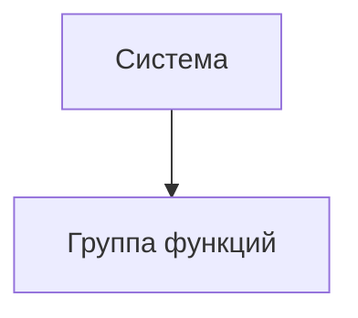

# Документ о концепции и границах кейса

| Поле | Значение |
|------|----------|
| Кейс | _название варианта_ |
| Индустриальный партнер | _организация / подразделение_ |
| Версия | `0.1-draft` |
| Дата | ГГГГ-ММ-ДД |
| Статус | черновик / на ревью / согласовано |
| Авторы | |

> [!NOTE]
> Заполняйте документ на языке заказчика. Образец глубины проработки — [`example/case_concept.md`](../example/case_concept.md). Колонки ID в таблицах шаблона — подсказка структуры, а не обязательная схема нумерации.

## 1. Введение

Краткая выжимка сути кейса: для кого система, какую проблему закрывает и чем отличается от текущего способа работы.

## 2. Бизнес-контекст и цели

### 2.1. Исходные данные

Как процесс устроен сейчас, какие потери времени / денег / качества наблюдаются, на каких фактах это основано.

### 2.2. Возможности бизнеса

Что изменится, если решение появится; какие смежные возможности откроются позже.

### 2.3. Бизнес-цели

| ID | Цель | Масштаб | Способ измерения | База | План | Обязательный порог | Срок |
|----|------|---------|------------------|------|------|--------------------|------|
| BO-1 | | | | | | | |
| BO-2 | | | | | | | |
| BO-3 | | | | | | | |

### 2.4. Видение решения

Одно-два предложения в формате: *для [пользователь], который [потребность], [имя системы] — это [тип продукта], который [ключевые возможности]. В отличие от [альтернатива], решение [отличие]*.

## 3. Стейкхолдеры

### 3.1. Профили заинтересованных лиц

| Заинтересованное лицо | Основная ценность | Отношение | Основные интересы | Ограничения |
|-----------------------|-------------------|-----------|-------------------|-------------|
| | | | | |

### 3.2. Матрица влияния / интереса

| Стейкхолдер | Влияние (низкое / среднее / высокое) | Интерес (низкий / средний / высокий) | Стратегия работы |
|-------------|--------------------------------------|--------------------------------------|------------------|
| | | | |

## 4. Функциональные требования

### 4.1. Основные функции

| ID | Функция | Краткое описание |
|----|---------|------------------|
| FE-1 | | |
| FE-2 | | |

### 4.2. Дерево функций

### 4.3. Пользовательские истории / варианты использования

| Основное действующее лицо | Варианты использования |
|---------------------------|------------------------|
| | |

### 4.4. Детальный сценарий (минимум один)

#### UC-1. _Название_

| Поле | Значение |
|------|----------|
| Автор / дата | |
| Основное действующее лицо | |
| Дополнительные действующие лица | |
| Описание | |
| Условие-триггер | |
| Предварительные условия | PRE-1. |
| Выходные условия | POST-1. |
| Приоритет | высокий / средний / низкий |
| Частота использования | |
| Бизнес-правила | BR-… |

**Нормальное направление**

1.
2.

**Альтернативные направления**

- 1.1 …

**Исключения**

- 1.0.E1 …

**Другая информация**

-

**Предположения**

-

### 4.5. Сжатые сценарии (по образцу Вигерса)

Остальные UC можно описать короче, если ключевая информация уже есть в другом источнике.

#### UC-n. _Название_

- Описание:
- Исключения:
- Приоритет:
- Бизнес-правила:
- Другая информация:

## 5. Нефункциональные требования

| ID | Категория | Требование | Метрика / порог |
|----|-----------|------------|-----------------|
| NFR-P1 | Производительность | | |
| NFR-A1 | Доступность | | |
| NFR-S1 | Безопасность | | |
| NFR-C1 | Совместимость / IT-ландшафт | | |
| NFR-U1 | Удобство использования | | |

## 6. Границы кейса

### 6.1. In Scope

- FE-1. Автоматический импорт готового расписания в формате JSON из корпоративной системы 1С:Университет ПРОФ.   
- FE-2. Оптимизация, очистка от дублирующихся записей разных служб и надежное хранение расписания во внутренней базе данных микросервиса Чат-бота MAX.
- FE-3. Выдача актуального расписания студентам и преподавателям по командам внутри мессенджера через Чат-бот MAX (MAX Bot).   
- FE-4. Автоматическая рассылка уведомлений пользователям в Чат-боте MAX при изменении расписания (отмены, переносы, смена аудитории или преподавателя).   
- FE-5. Разработка отдельного веб-сервиса Мини-приложения (MAX Mini App), который открывается внутри мессенджера MAX (через WebView) и доступен в веб-браузере, получая данные о расписании по API от микросервиса Чат-бота.
- FE-6. Формирование сводной аналитики и отчетов по загрузке аудиторий и преподавателей на основе хранимого расписания.

### 6.2. Out of Scope

- LI-1. Разработка автоматизированного рабочего места (АРМ) диспетчера и сеточного конструктора для ручного составления расписания (система импортирует уже сформированное расписание из внешних систем вуза).   
- LI-2. Первичный учет, ввод и редактирование справочников кадрового состава, контингента студентов, аудиторного фонда и учебных планов (ведутся во внешних системах вуза).   
- LI-3. Разработка нативных мобильных приложений под ОС iOS и Android для магазинов App Store и Google Play (клиентский доступ обеспечивается через Чат-бот MAX и веб-сервис Mini App).   
- LI-4. Учет посещаемости занятий, ведение электронных журналов успеваемости и выставление оценок.   
- LI-5. Автоматическая генерация сетки расписания с использованием алгоритмов искусственного интеллекта и нейросетей.

### 6.3. Состав первого и последующих выпусков

| Функция | Выпуск 1 | Выпуск 2 | Выпуск 3 |
|---------|----------|----------|----------|
| FE-1. Автоматический импорт из 1С | Автоматический импорт готового расписания (JSON) из 1С по расписанию (таймеру) в микросервис Чат-бота. | Мгновенное получение изменений расписания из 1С через входящие вебхуки. | Импорт расписания экзаменационной сессии и графика пересдач из смежных систем вуза. |
| FE-2. Оптимизация и хранение в БД бота | Очистка импортируемого расписания от дублей разных служб и сохранение в БД микросервиса бота с защитой от потери данных при сбоях. | Версионирование расписания и автоматическое выделение дельты изменений. | Хранение исторических архивов расписаний за прошлые семестры для аналитики. |
| FE-3. Выдача расписания в Чат-боте MAX | Работа внутри мессенджера MAX: выдача расписания на сегодня/завтра по кнопкам и командам; отдача данных по API для сервиса Mini App. | Поддержка поиска расписания по фамилии преподавателя и номеру аудитории прямо в чате бота. | Персональные подписки на несколько учебных групп или преподавателей одновременно. |
| FE-4. Уведомления об изменениях в боте | Информирование пользователя о времени последнего обновления расписания при запросе в чате. | Автоматическая рассылка адресных push-уведомлений студентам и преподавателям в Чат-боте MAX при переносах и отменах пар. | Настраиваемые напоминания за 15 минут до начала занятия с указанием корпуса и аудитории. |
| FE-5. Отдельный веб-сервис Mini App | Веб-приложение (работает во встроенном WebView мессенджера MAX и в браузере): обращение к API Чат-бота, просмотр расписания группы и преподавателя на неделю. | Фильтрация по типам занятий (лекция, практика, лабораторная), четности недель и поиск свободных аудиторий. | Наложение расписания внеучебных мероприятий вуза и экспорт в личный календарь. |
| FE-6. Отчетность и аналитика | Базовая сводка по импортированным записям и количеству устраненных дублей расписания. | Отчеты по фактической загрузке аудиторий (%) и преподавателей (часы) с выгрузкой в PDF. | Статистика пользовательской активности (число запросов в Чат-боте и просмотров в Mini App). |

## 7. Ограничения и допущения

### 7.1. Ограничения и исключения

См. ограничения LI-1 - LI-5 в подразделе 6.2. Out of Scope.

### 7.2. Предположения и зависимости

| ID | Тип | Формулировка |
|----|-----|--------------|
| AS-1 | допущение | Система 1С:Университет ПРОФ отдает готовое расписание в формате JSON со всеми необходимыми атрибутами (группа, дисциплина, преподаватель, аудитория, временной слот). |
| AS-2 | допущение | Микросервис Чат-бота имеет сетевой доступ к HTTP-сервису 1С для автоматического импорта и открыт для сетевых запросов со стороны отдельного веб-сервиса Mini App. |
| AS-3 | допущение | Все данные, передаваемые между 1С, микросервисом Чат-бота, платформой MAX и веб-сервисом Mini App, зашифрованы по протоколу HTTPS (TLS). |
| DE-1 | зависимость | Работа Чат-бота зависит от доступности платформы мессенджера MAX и получения авторизационного токена бота (Bearer Token). |
| DE-2 | зависимость | Автоматический импорт готового расписания зависит от доступности HTTP-сервиса 1С и предоставления учетных данных для авторизации со стороны ИТ-отдела вуза. |
| DE-3 | зависимость | Работа отдельного веб-сервиса Mini App напрямую зависит от доступности API микросервиса Чат-бота, который хранит в себе расписание и отдает его по запросу. |

### 7.3. Приоритеты проекта

| Область | Ограничения | Движущая сила | Степень свободы |
|---------|-------------|---------------|-----------------|
| Функции | В Выпуске 1 должны быть полностью реализованы функции FE-1..FE-6 в объеме MVP: автоимпорт готового JSON из 1С, хранение в БД Чат-бота, работа бота в MAX и отдельный веб-сервис Mini App. | | |
| Качество | | Безошибочный автоматический импорт расписания с очисткой от дублей, сохранение целостности базы данных при сбоях и полное шифрование передаваемых данных. | |
| Сроки | | | Релиз первого выпуска должен состояться за 2 недели до начала учебного семестра; допустимо смещение сроков не более чем на 7 календарных дней по согласованию с куратором. |
| Расходы | | | Бюджет фиксирован рамками студенческой разработки; превышение использования инфраструктурных мощностей вуза не более 10% без пересмотра куратором. |
| Персонал | | | Команда проекта: аналитик, 2 разработчика, инженер по интеграции/тестированию; при необходимости привлекается консультант ИТ-отдела вуза на 0,25 ставки. |

### 7.4. Особенности развертывания

Решение развертывается на серверах под управлением ОС Linux и состоит из двух отдельных сервисов:   
1. Микросервис Чат-бота MAX (с собственной базой данных): размещается в серверном контуре университета. Сервис автоматически подключается к HTTP-сервису 1С по зашифрованному каналу HTTPS, импортирует готовое расписание в формате JSON, очищает его от дублей и сохраняет в свою базу данных. С платформой MAX бот взаимодействует с помощью авторизации по токену (Bearer Token) и обрабатывает события пользователей через вебхуки.   
2. Отдельный веб-сервис Мини-приложения (Mini App): разворачивается как самостоятельное веб-приложение с публичным HTTPS-доступом. Внутри мессенджера MAX оно открывается во встроенном WebView-контейнере, а также может быть открыто напрямую в веб-браузере по ссылке. Сервис Mini App не хранит расписание у себя, а обращается по защищенному API к микросервису Чат-бота и получает актуальные данные. Все передаваемые данные между узлами системы зашифрованы.

## 8. Риски

| ID | Риск | Вероятность (0–1) | Ущерб (1–10) | Митигация |
|----|------|-------------------|--------------|-----------|
| RI-1 | Дублирование записей или ошибки в готовом JSON-расписании, формируемом разными службами в 1С | 0,7 | 8 | Реализовать при импорте в микросервис Чат-бота автоматическую валидацию и дедупликацию записей; при получении поврежденного файла отменять транзакцию обновления, сохраняя текущее рабочее расписание в базе данных. |
| RI-2 | Временная недоступность сервера 1С в момент автоматического импорта расписания | 0,5 | 7 | Хранить актуальное расписание внутри собственной базы данных микросервиса Чат-бота: при недоступности 1С и бот, и веб-сервис Mini App продолжают бесперебойно выдавать пользователям сохраненное расписание. |
| RI-3 | Превышение лимитов пропускной способности платформы MAX при массовой рассылке уведомлений Чат-ботом | 0,5 | 6 | Реализовать отправку уведомлений через асинхронную очередь с дроблением на порции (батчи по 100–300 сообщений) и задержками между запросами. |
| RI-4 | Кратковременная потеря связи между отдельным веб-сервисом Mini App и микросервисом Чат-бота | 0,3 | 7 | Настроить кэширование полученных данных расписания в браузере пользователя, чтобы открытая сетка оставалась доступной при перебоях сети. |
| RI-5 | Несогласованное изменение структуры JSON-файла расписания на стороне 1С | 0,4 | 8 | Проверять структуру входящего JSON по схеме перед импортом в БД бота; при несовпадении структуры отклонять импорт с сохранением действующего расписания и уведомлять администратора. |

## 9. Критерии приемки

| ID | Критерий | Как проверяется | Порог | Срок |
|----|----------|-----------------|-------|------|
| SM-1 | Исключение ручного перебивания и дублирования при доставке расписания в MAX | Проверка процесса доставки расписания от выгрузки из 1С до появления в Чат-боте и Mini App | 100% автоматический импорт готового расписания из 1С (0 ручных правок) | Приемка выпуска 1 |
| SM-2 | Охват студентов и преподавателей через Чат-бот MAX и веб-сервис Mini App | Статистика пользователей Чат-бота и открытий веб-приложения Mini App | Не менее 75% студентов и 60% преподавателей используют сервис | 1 месяц после релиза |
| SM-3 | Быстродействие выдачи расписания из базы микросервиса Чат-бота | Замер времени ответа Чат-бота на команду и загрузки расписания в Mini App | Менее 2 секунд на отображение расписания группы или преподавателя | Приемка Выпуска 1 |
| AC-1 | Реализация функционального объема Выпуска 1 (FE-1..FE-6) | Чек-лист приемочного тестирования автоимпорта, хранения в БД бота, выдачи в боте и работы Mini App | 100% запланированных сценариев Выпуска 1 выполнены успешно | Приемка выпуска 1 |
| AC-2 | Работоспособность Чат-бота внутри мессенджера MAX | Тестирование команд бота в мессенджере MAX после автоматического импорта JSON из 1С | Бот хранит расписание в собственной БД и безошибочно выдает его пользователям в чате | Приемка выпуска 1 |
| AC-3 | Работа отдельного веб-сервиса Mini App (внутри MAX и в веб-браузере) | Открытие Mini App во встроенном WebView мессенджера MAX и в браузере; проверка загрузки расписания от сервиса Чат-бота | Веб-сервис открывается в обоих режимах и корректно отображает данные, полученные от бота | Приемка выпуска 1 |
| AC-4 | Сохранение целостности расписания при сбоях и шифрование данных | Подача поврежденного JSON / отключение 1С; проверка шифрования соединения (HTTPS) между всеми сервисами | 100% сохранение рабочего расписания в БД бота без потери записей; все данные зашифрованы | Приемка выпуска 1 |

Учебное управление принимает систему Выпуска 1, если в полном объеме выполнены критерии AC-1, AC-2, AC-3 и AC-4, подтверждающие, что микросервис Чат-бота автоматически импортирует готовое расписание в формате JSON из 1С, очищает его от дублей, хранит в собственной базе данных и выдает пользователям внутри MAX, отдельный веб-сервис Mini App получает данные от бота и корректно отображает их, а все данные передаются в зашифрованном виде с сохранением целостности базы при внешних сбоях. Метрики эффективности SM-1...SM-3 служат целевыми показателями (KPI) ввода системы в эксплуатацию.
