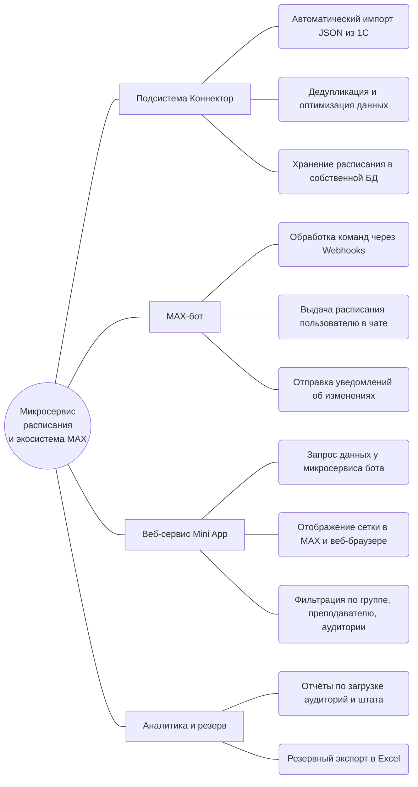

## Документ о концепции и границах кейса

| Поле | Значение |
|------|----------|
| Кейс | Расписание занятий в MAX |
| Индустриальный партнер | Учебное управление университета РИАТПО |
| Версия | `v1.0-concept-freeze` |
| Дата | 2026-10-07 |
| Статус | Согласовано |
| Авторы | Ежов Д.Д., Игнатов М.Р., Тюрин С.С.|

## 1. Введение

Учебное управление университета тратит слишком много времени на формирование расписания: данные о факультетах, кафедрах, аудиториях, преподавателях, группах и учебных планах уже есть в 1С:Университет ПРОФ, но их перепечатывают заново. Из-за этого расписание появляется поздно, ошибки всплывают в первую учебную неделю, а загрузку преподавателей и аудиторий приходится считать вручную. Студенты и преподаватели ищут расписание на портале.

Наша система - это микросервис и интеграционный коннектор, который автоматически импортирует готовое расписание и справочники в формате JSON из 1С:Университет ПРОФ. Система очищает данные от дублей, сохраняет их в собственной базе и отдает пользователям через MAX-бот и веб-сервис Mini App. В отличие от текущего способа, где расписание приходится искать на портале, наше решение автоматически доставляет актуальную сетку прямо в мессенджер и браузер студента или преподавателя.

## 2. Бизнес-контекст и цели

### 2.1. Исходные данные

Сейчас расписание собирается слишком долго. 
Одни сотрудники или даже один заводят кафедры и аудитории, другие преподавателей и группы, сводят сетку занятий в таблицах. 
Данные при этом уже есть в информационных системах, но ими почти не пользуются,  итоге всё перепечатывают заново.

Из-за этого расписание появляется поздно, ошибки всплывают уже в первую учебную неделю.

Сейчас данные о расписании формируются в 1С, но до студентов и преподавателей доходят неудобным способом - через вложенные страницы портала. Кроме того, разные службы вуза могут дублировать информацию. Из-за этого возникают ошибки, а на поиск нужной пары уходит время.

### 2.2. Возможности бизнеса

Если решение появится, учебное заведение сможет собирать расписание быстрее и с меньшим числом ручных операций. Данные о факультетах, кафедрах, аудиториях, преподавателях, группах и учебных планах будут загружаться из 1С:Университет автоматически.

Учебное управление получит отчёты по загрузке преподавателей и аудиторий чтобы принимать решения: где перегруз, где простой, где нельзя поставить ещё одну пару. В итоге студенты и преподаватели получают актуальную сетку в MAX-боте или в Mini App .
### 2.3. Бизнес-цели

| ID | Цель | Масштаб | Способ измерения | База | План | Обязательный порог | Срок |
|----|------|---------|------------------|------|------|--------------------|------|
| BREQ-1 | Сократить время сборки расписания на семестр | Трудозатраты учебного управления |Замер времени от начала сборки до публикации | | −50%|−30% |В течение первого семестра после запуска |
| BREQ-2 | Обеспечить прозрачную загрузку преподавателей и аудиторий|Наличие отчётов в системе |Проверка доступности отчётов |всё вручную |2 отчёта |2 отчёта | К концу выпуска  |
| BREQ-3 |Донести расписание до студентов и преподавателей в MAX | Доля людей, видящих расписание в MAX|Статистика мини-приложения и чат-бота | 0% | ≥80% |≥60% |В течение 3 месяцев после запуска |
| BREQ-4 | Исключить риск потери данных при сбоях интеграции | Количество инцидентов с потерей сетки | Проверка журнала ошибок и восстановления | нет данных | 0 инцидентов | 0 инцидентов | Приемка выпуска 1 |
| BREQ-5 | Обеспечить 100% прозрачность действий сотрудников | Наличие логов авторизации | Проверка журнала аудита, кто и когда опубликовал | отсутствует | 100% операций логируются | 100% операций логируются | Приемка выпуска 1 |
| BREQ-6 | Автоматизировать рутинные операции диспетчера | Количество ручных вводов | Аудит базы данных на наличие ручных записей | 100% ручной ввод | 0% ручного ввода (всё из 1С) | 0% ручного ввода | Приемка выпуска 1 |

### 2.4. Видение решения

Для учебного управления и студентов, система расписания в MAX - это автономный микросервис и интеграционный коннектор, который автоматически импортирует готовое расписание из 1С, очищает его от дублей и отдает в MAX-бот и веб-сервис Mini App. В отличие от текущего способа поиска файлов на портале, наше решение доставляет данные туда, где пользователь уже читает сообщения.

## 3. Бизнес-контекст и стейкхолдеры

### 3.1 Профили заинтересованных лиц

| Стейкхолдер | Описание и роль в проекте | Главная ценность от системы |
| :--- | :--- | :--- |
| **Учебное управление (Заказчик)** | Инициатор проекта. Контролирует актуальность расписания и аналитику загруженности. | Автоматическая оптимизация и сведение разрозненных данных о расписании в единый источник без ручного дублирования; прозрачные отчёты по аудиториям и преподавателям. |
| **Студенты и Преподаватели** | Основные конечные пользователи Чат-бота (MAX Bot) и веб-сервиса (Mini App). | Мгновенный доступ к расписанию через команды бота внутри MAX или через веб-интерфейс Mini App (в мессенджере и браузере). |
| **ИТ-отдел университета** | Владелец корпоративной системы 1С:Университет ПРОФ (источник готового JSON расписания и справочников). | Автоматический импорт данных подсистемой-коннектором по расписанию/вебхукам с соблюдением таймаутов.|
| **Платформа MAX (MAX Bridge API)** | Внешняя платформа мессенджера, в которой функционирует наш MAX-бот. | Корректный обмен событиями через вебхуки (Webhooks) и авторизация запросов к API через защищённый токен. |
| **Диспетчер расписания** | Оператор со стороны вуза, отслеживающий статус автоматического импорта и отчёты. | Отсутствие ручной перепечатки: коннектор сам импортирует готовое расписание из 1С и доставляет его в бот и Mini App. |

### 3.2 Матрица влияния / интереса

| Стейкхолдер | Влияние | Интерес | Стратегия взаимодействия |
| :--- | :--- | :--- | :--- |
| Учебное управление | Высокое | Высокий | **Плотно взаимодействовать**. Согласовывать правила дедупликации данных и формат отчётов. |
| ИТ-отдел университета | Высокое | Низкий | **Удовлетворять потребности**. Соблюдать регламент HTTP-запросов к 1С |
| Платформа MAX | Высокое | Средний | **Удовлетворять потребности**. Корректно обрабатывать вебхуки и использовать токен-авторизацию. |
| Студенты и Преподаватели | Низкое | Высокий | **Информировать**. Обеспечить стабильную работу MAX-бота и доступность веб-сервиса Mini App в интернете и мессенджере. |
| Диспетчер расписания | Низкое | Высокий | **Информировать и вовлекать**. Предоставить удобный мониторинг импорта и выгрузки. |

## 4. Функциональные требования

### 4.1. Основные функции

| ID | Функция | Краткое описание |
|----|---------|------------------|
| FE-1 | Автоматический импорт данных| Импорт справочников и готового расписания в формате JSON через API 1С |
| FE-2 | Дедупликация и оптимизация |Очистка импортированных данных от дублей и сохранение в БД микросервиса |
| FE-3 | Обработка команд бота | Прием вебхуков от MAX-бота и выдача текстового расписания |
| FE-4 | Работа веб-сервиса Mini App |Отдача данных для отрисовки интерактивной сетки расписания |
| FE-5 | Отчёты по загрузке |Формирование отчетов по нагрузке преподавателей и аудиторий на основе БД |
| FE-6 | Уведомления в Chat Bot | Отправка push-уведомлений об изменениях и запрос расписания на день |

### 4.2. Дерево функций

### 4.2. Дерево функций

### 4.3. Пользовательские истории / варианты использования

| ID | Основное действующее лицо | Пользовательская история (User Story) | Связанное FR | Приоритет |
|---|---|---|---|---|
| US-1 | Коннектор | Как подсистема Коннектор, я должна автоматически импортировать готовое расписание и справочники в формате JSON из 1С, чтобы исключить ручной ввод и дублирование данных | FE-1, FE-2 | Высокий |
| US-2 | Студент / Преподаватель | Как Пользователь, я хочу запрашивать своё расписание в MAX-боте и мгновенно получать ответ в чате, чтобы быстро узнавать пары без поиска файлов на сайте вуза | FE-3 | Высокий |
| US-3 | Студент / Преподаватель | Как Пользователь, я хочу открывать веб-сервис Mini App (как внутри мессенджера MAX, так и в браузере), чтобы наглядно просматривать сетку расписания на неделю | FE-4 | Высокий |
| US-4 | Учебное управление | Как Учебное управление, я хочу видеть в системе автоматические отчёты по занятости аудиторий и загрузке преподавателей на основе импортированного расписания, чтобы выявлять простои и накладки | FE-5 | Средний |
| US-5 | Коннектор |  Как Коннектор, я хочу, чтобы при обновлении JSON-расписания в 1С я автоматически фиксировала изменения и инициировала рассылку через MAX-бот, чтобы расписание в мессенджере всегда было синхронизировано с 1С | FE-6 | Высокий |
| US-6 | Пользователь | Как Пользователь, я хочу иметь возможность выгрузить хранимое в микросервисе расписание в файл .xlsx по шаблону MAX, чтобы иметь резервный канал передачи данных | NFR-C2 | Низкий |

### 4.4. Детальный сценарий (UC-1, UC-2)

#### UC-1. Автоматический импорт готового расписания Коннектором и выдача через MAX-бот и Mini App

| Поле | Значение |
|------|----------|
| Автор / дата | Аналитик команды 2 / 2026-10-08 |
| Основное действующее лицо | Подсистема Коннектор / Студент (Преподаватель) |
| Дополнительные действующие лица | ИТ-система 1С:Университет ПРОФ, MAX Bridge API, Веб-сервис Mini App |
| Описание | Подсистема Коннектор автоматически импортирует готовое расписание в формате JSON из 1С, оптимизирует и сохраняет его внутри микросервиса, после чего MAX-бот и отдельный веб-сервис Mini App выдают эти данные пользователям по запросу. |
| Условие-триггер | Наступление времени плановой синхронизации с 1С ИЛИ входящий вебхук (Webhook) от пользователя из мессенджера MAX / HTTP-запрос от веб-сервиса Mini App. |
| Предварительные условия | PRE-1. Данные в 1С сформированы и доступны по HTTP-сервисам. PRE-2. Между микросервисом, 1С и MAX настроены шифрованные каналы связи, Basic-авторизация (для 1С) и токен-авторизация (для MAX). |
| Выходные условия | POST-1. Актуальное расписание импортировано, дедуплицировано и сохранено в БД микросервиса. POST-2. Пользователь получил актуальное расписание в интерфейсе MAX-бота или веб-сервиса Mini App. |
| Приоритет | Высокий (Критический функционал) |
| Бизнес-правила | BR-1. Все дублирующиеся записи из разных служб вуза при импорте сводятся к единой эталонной записи. **BR-2. Аудитория не может быть занята разными группами одновременно (кроме потоковых лекций) — при обнаружении коллизии в импортированном JSON система помечает конфликт для отчёта.** |

**Нормальное направление**

1. Подсистема Коннектор по расписанию отправляет HTTP GET-запрос к сервисам 1С с заголовком `Authorization: Basic`.
2. Система 1С возвращает готовое расписание и связанные справочники в формате JSON по зашифрованному каналу.
3. Коннектор импортирует JSON, отсекает мусорные префиксы, устраняет дубликаты, проверяет данные по правилу BR-2 и сохраняет оптимизированное расписание в собственной базе данных микросервиса.
4. Коннектор при наличии изменений отправляет пакет данных через `POST /v1/bulk/events` в MAX Bridge API (с авторизацией по Bearer-токену).
5. Когда пользователь в мессенджере MAX запрашивает расписание, платформа MAX отправляет **вебхук (Webhook)** (HTTP POST-уведомление о событии) на сервер нашего MAX-бота.
6. MAX-бот мгновенно берёт сохранённое внутри микросервиса расписание и отправляет ответное сообщение пользователю в чат.
7. Если пользователь открывает **Mini App** (внутри мессенджера или как отдельный сайт в браузере), веб-сервис Mini App обращается по API к микросервису бота (с проверкой токена), получает JSON с расписанием и отрисовывает визуальную сетку занятий.

**Исключения**

- 2.0.E1. *Сервер 1С или внешний шлюз временно недоступен:* Коннектор прерывает сеанс импорта по таймауту. Ранее импортированное расписание внутри микросервиса остаётся нетронутым («гарантийно слома нет»), и MAX-бот с Mini App продолжают бесперебойно отдавать пользователям сохранённую версию.

#### UC-2. Импорт и актуализация базовых справочников из 1С:Университет ПРОФ

| Поле | Значение |
|------|----------|
| Автор / дата | Аналитик команды 2 / 2026-10-08 |
| Основное действующее лицо | Подсистема Коннектор |
| Дополнительные действующие лица | ИТ-система 1С:Университет ПРОФ |
| Описание | Автоматический импорт актуальных данных о подразделениях, аудиториях, преподавателях, группах и учебных планах из корпоративной системы 1С в базу микросервиса. |
| Условие-триггер | Запуск регламентного задания импорта в подсистеме Коннектор. |
| Предварительные условия | PRE-1. В настройках коннектора заданы URL-адреса HTTP-сервисов 1С и учётные данные для Basic-авторизации. PRE-2. Сервер 1С доступен в сети. |
| Выходные условия | POST-1. Внутренняя база данных микросервиса обновлена актуальными справочниками из 1С. |
| Приоритет | Высокий (Критический функционал) |
| Частота использования | Автоматически (по расписанию) или по запросу. |
| Бизнес-правила | BR-3. Ранее импортированные записи, задействованные в активном расписании, при исчезновении из выгрузки 1С не удаляются физически (применяется мягкая архивация), чтобы гарантировать целостность расписания в боте и Mini App. |

**Нормальное направление**

1. Подсистема Коннектор инициирует сеанс автоматического импорта.
2. Коннектор последовательно отправляет HTTP GET-запросы к эндпоинтам 1С (`Department_University`, `employees_v1`, `study_groups`, `list_curricula`).
3. Система 1С обрабатывает запросы и возвращает ответы в формате JSON.
4. Коннектор импортирует полученные файлы (отрезает служебные префиксы до первой `{` или `[`, проверяет валидность структуры JSON).
5. Микросервис обновляет данные в своей базе (сводит дубликаты, обновляет изменившиеся атрибуты).
6. Микросервис фиксирует успешное завершение импорта и количество обновлённых записей.

**Альтернативные направления**

- 2.1. *Точечный импорт дисциплин и нагрузки:* Для получения деталей учебных планов (`disciplines_departments`) коннектор берёт импортированные номера планов (`plan_number`) и выполняет отдельный GET-запрос на каждый номер плана.

**Исключения**

- 3.0.E1. *Превышение таймаута:* Система 1С не отвечает в течение установленного лимита (1800 с для тяжелых справочников, 600 с для легких). Коннектор прерывает ожидание для текущего эндпоинта и оставляет в базе микросервиса предыдущую рабочую копию данных.
- 4.0.E1. *Некорректный формат ответа:* Система 1С возвращает ответ с флагом `"error": true` или повреждённый JSON. Коннектор отбрасывает битый пакет, сохраняя целостность текущего расписания в микросервисе.

**Другая информация**

- Размер импортируемого файла может достигать 2 ГБ, а обработка в оперативной памяти ограничена 400 МБ. Коннектор использует потоковое чтение данных.

**Предположения**

- Предполагается, что ИТ-отдел вуза уведомляет об изменениях схемы JSON-выгрузок заранее.

### 4.5 Сжатые Use Cases (UC-3, UC-4)

* **UC-3: Просмотр аналитики загруженности аудиторий и преподавателей.** Сотрудник Учебного управления запрашивает отчёт. Микросервис на основе импортированного и хранимого в себе расписания автоматически рассчитывает часы нагрузки преподавателей, выявляет простои или пересечения по аудиториям (BR-2) и выдаёт готовую сводку.
* **UC-4: Взаимодействие автономного веб-сервиса Mini App с микросервисом бота.** Пользователь открывает Mini App по прямой веб-ссылке в браузере или внутри мессенджера MAX. Фронтенд Mini App отправляет запрос к API нашего микросервиса (MAX-бота), получает актуальный срез расписания и отображает его с фильтрацией по группе, преподавателю или свободным аудиториям.
 
## 5. Нефункциональные требования (NFR)

## 5. Нефункциональные требования (NFR)

| ID | Категория | Требование | Метрика / порог |
|----|-----------|------------|-----------------|
| NFR-P1 | Производительность | Подсистема Коннектор должна успешно импортировать и обрабатывать в оперативной памяти JSON-ответы от 1С | Максимальный объем в ОЗУ — 400 МБ |
| NFR-P2 | Производительность | Коннектор должен поддерживать скачивание объёмных JSON-выгрузок из 1С во временное хранилище | Максимальный размер файла — 2 ГБ |
| NFR-A1 | Доступность и Надежность | Коннектор должен поддерживать длительное ожидание ответа при импорте тяжелых узлов 1С (`Department_University`, `employees_v1`) | Таймаут — 1800 секунд |
| NFR-A2 | Доступность и Надежность | Коннектор должен обрывать зависшие запросы к легким эндпоинтам 1С (`study_groups`, `list_curricula`) | Таймаут — 600 секунд |
| NFR-A3 | Доступность и Надежность | Автономность и защита от сбоев («гарантийно слома нет»): микросервис хранит импортированное расписание в собственной БД и продолжает отдавать его в MAX-бот и Mini App даже при полном отказе 1С | 0% потерь данных и 100% доступность чтения при сбое 1С |
| NFR-D1 | Шифрование данных | Все данные системы (как при передаче между 1С, микросервисом бота и веб-сервисом Mini App по TLS/HTTPS, так и при хранении в БД) зашифрованы | 100% трафика и хранилища зашифровано |
| NFR-C1 | Совместимость (Транспорт и Авторизация) | Разграничение механизмов авторизации и асинхронного обмена: импорт из 1С выполняется по схеме `Basic Auth` (`Authorization: Basic <base64>`), а взаимодействие с MAX Bridge API, приём событий через вебхуки (Webhooks) и запросы от Mini App — по защищённому `Bearer-токену` | 100% соответствие протоколам авторизации |
| NFR-C2 | Совместимость / IT-ландшафт | Коннектор должен автоматически отсекать произвольный неформатированный текст-префикс в ответах 1С до первого символа `{` или `[` и поддерживать резервный экспорт в `.xlsx` | 100% успешный импорт ответов с префиксом |
| NFR-U1 | Удобство использования | Полная автоматизация доставки: расписание переносится из 1С в MAX-бот и веб-сервис Mini App без ручного перепечатывания справочников и пар | 0% ручного дублирования данных |

## 6. Границы кейса

### 6.1. In Scope

- FE-1. Автоматический импорт готового расписания в формате JSON из корпоративной системы 1С:Университет ПРОФ.   
- FE-2. Оптимизация, очистка от дублирующихся записей разных служб и надежное хранение расписания во внутренней базе данных микросервиса Чат-бота MAX.
- FE-3. Выдача актуального расписания студентам и преподавателям по командам внутри мессенджера через Чат-бот MAX (MAX Bot).   
- FE-4. Автоматическая рассылка уведомлений пользователям в Чат-боте MAX при изменении расписания (отмены, переносы, смена аудитории или преподавателя).   
- FE-5. Разработка отдельного веб-сервиса Мини-приложения (MAX Mini App), который открывается внутри мессенджера MAX (через WebView) и доступен в веб-браузере, получая данные о расписании по API от микросервиса Чат-бота.
- FE-6. Формирование сводной аналитики и отчетов по загрузке аудиторий и преподавателей на основе хранимого расписания.

### 6.2. Out of Scope

- LI-1. Разработка автоматизированного рабочего места (АРМ) диспетчера и сеточного конструктора для ручного составления расписания (система импортирует уже сформированное расписание из внешних систем вуза).   
- LI-2. Первичный учет, ввод и редактирование справочников кадрового состава, контингента студентов, аудиторного фонда и учебных планов (ведутся во внешних системах вуза).   
- LI-3. Разработка нативных мобильных приложений под ОС iOS и Android для магазинов App Store и Google Play (клиентский доступ обеспечивается через Чат-бот MAX и веб-сервис Mini App).   
- LI-4. Учет посещаемости занятий, ведение электронных журналов успеваемости и выставление оценок.   
- LI-5. Автоматическая генерация сетки расписания с использованием алгоритмов искусственного интеллекта и нейросетей.

### 6.3. Состав первого и последующих выпусков

| Функция | Выпуск 1 | Выпуск 2 | Выпуск 3 |
|---------|----------|----------|----------|
| FE-1. Автоматический импорт из 1С | Автоматический импорт готового расписания (JSON) из 1С по расписанию (таймеру) в микросервис Чат-бота. | Мгновенное получение изменений расписания из 1С через входящие вебхуки. | Импорт расписания экзаменационной сессии и графика пересдач из смежных систем вуза. |
| FE-2. Оптимизация и хранение в БД бота | Очистка импортируемого расписания от дублей разных служб и сохранение в БД микросервиса бота с защитой от потери данных при сбоях. | Версионирование расписания и автоматическое выделение дельты изменений. | Хранение исторических архивов расписаний за прошлые семестры для аналитики. |
| FE-3. Выдача расписания в Чат-боте MAX | Работа внутри мессенджера MAX: выдача расписания на сегодня/завтра по кнопкам и командам; отдача данных по API для сервиса Mini App. | Поддержка поиска расписания по фамилии преподавателя и номеру аудитории прямо в чате бота. | Персональные подписки на несколько учебных групп или преподавателей одновременно. |
| FE-4. Уведомления об изменениях в боте | Информирование пользователя о времени последнего обновления расписания при запросе в чате. | Автоматическая рассылка адресных push-уведомлений студентам и преподавателям в Чат-боте MAX при переносах и отменах пар. | Настраиваемые напоминания за 15 минут до начала занятия с указанием корпуса и аудитории. |
| FE-5. Отдельный веб-сервис Mini App | Веб-приложение (работает во встроенном WebView мессенджера MAX и в браузере): обращение к API Чат-бота, просмотр расписания группы и преподавателя на неделю. | Фильтрация по типам занятий (лекция, практика, лабораторная), четности недель и поиск свободных аудиторий. | Наложение расписания внеучебных мероприятий вуза и экспорт в личный календарь. |
| FE-6. Отчетность и аналитика | Базовая сводка по импортированным записям и количеству устраненных дублей расписания. | Отчеты по фактической загрузке аудиторий (%) и преподавателей (часы) с выгрузкой в PDF. | Статистика пользовательской активности (число запросов в Чат-боте и просмотров в Mini App). |

## 7. Ограничения и допущения

### 7.1. Ограничения и исключения

См. ограничения LI-1 - LI-5 в подразделе 6.2. Out of Scope.

### 7.2. Предположения и зависимости

| ID | Тип | Формулировка |
|----|-----|--------------|
| AS-1 | допущение | Система 1С:Университет ПРОФ отдает готовое расписание в формате JSON со всеми необходимыми атрибутами (группа, дисциплина, преподаватель, аудитория, временной слот). |
| AS-2 | допущение | Микросервис Чат-бота имеет сетевой доступ к HTTP-сервису 1С для автоматического импорта и открыт для сетевых запросов со стороны отдельного веб-сервиса Mini App. |
| AS-3 | допущение | Все данные, передаваемые между 1С, микросервисом Чат-бота, платформой MAX и веб-сервисом Mini App, зашифрованы по протоколу HTTPS (TLS). |
| DE-1 | зависимость | Работа Чат-бота зависит от доступности платформы мессенджера MAX и получения авторизационного токена бота (Bearer Token). |
| DE-2 | зависимость | Автоматический импорт готового расписания зависит от доступности HTTP-сервиса 1С и предоставления учетных данных для авторизации со стороны ИТ-отдела вуза. |
| DE-3 | зависимость | Работа отдельного веб-сервиса Mini App напрямую зависит от доступности API микросервиса Чат-бота, который хранит в себе расписание и отдает его по запросу. |

### 7.3. Приоритеты проекта

| Область | Ограничения | Движущая сила | Степень свободы |
|---------|-------------|---------------|-----------------|
| Функции | В Выпуске 1 должны быть полностью реализованы функции FE-1..FE-6 в объеме MVP: автоимпорт готового JSON из 1С, хранение в БД Чат-бота, работа бота в MAX и отдельный веб-сервис Mini App. | | |
| Качество | | Безошибочный автоматический импорт расписания с очисткой от дублей, сохранение целостности базы данных при сбоях и полное шифрование передаваемых данных. | |
| Сроки | | | Релиз первого выпуска должен состояться за 2 недели до начала учебного семестра; допустимо смещение сроков не более чем на 7 календарных дней по согласованию с куратором. |
| Расходы | | | Бюджет фиксирован рамками студенческой разработки; превышение использования инфраструктурных мощностей вуза не более 10% без пересмотра куратором. |
| Персонал | | | Команда проекта: аналитик, 2 разработчика, инженер по интеграции/тестированию; при необходимости привлекается консультант ИТ-отдела вуза на 0,25 ставки. |

### 7.4. Особенности развертывания

Решение развертывается на серверах под управлением ОС Linux и состоит из двух отдельных сервисов:   
1. Микросервис Чат-бота MAX (с собственной базой данных): размещается в серверном контуре университета. Сервис автоматически подключается к HTTP-сервису 1С по зашифрованному каналу HTTPS, импортирует готовое расписание в формате JSON, очищает его от дублей и сохраняет в свою базу данных. С платформой MAX бот взаимодействует с помощью авторизации по токену (Bearer Token) и обрабатывает события пользователей через вебхуки.   
2. Отдельный веб-сервис Мини-приложения (Mini App): разворачивается как самостоятельное веб-приложение с публичным HTTPS-доступом. Внутри мессенджера MAX оно открывается во встроенном WebView-контейнере, а также может быть открыто напрямую в веб-браузере по ссылке. Сервис Mini App не хранит расписание у себя, а обращается по защищенному API к микросервису Чат-бота и получает актуальные данные. Все передаваемые данные между узлами системы зашифрованы.

## 8. Риски

| ID | Риск | Вероятность (0–1) | Ущерб (1–10) | Митигация |
|----|------|-------------------|--------------|-----------|
| RI-1 | Дублирование записей или ошибки в готовом JSON-расписании, формируемом разными службами в 1С | 0,7 | 8 | Реализовать при импорте в микросервис Чат-бота автоматическую валидацию и дедупликацию записей; при получении поврежденного файла отменять транзакцию обновления, сохраняя текущее рабочее расписание в базе данных. |
| RI-2 | Временная недоступность сервера 1С в момент автоматического импорта расписания | 0,5 | 7 | Хранить актуальное расписание внутри собственной базы данных микросервиса Чат-бота: при недоступности 1С и бот, и веб-сервис Mini App продолжают бесперебойно выдавать пользователям сохраненное расписание. |
| RI-3 | Превышение лимитов пропускной способности платформы MAX при массовой рассылке уведомлений Чат-ботом | 0,5 | 6 | Реализовать отправку уведомлений через асинхронную очередь с дроблением на порции (батчи по 100–300 сообщений) и задержками между запросами. |
| RI-4 | Кратковременная потеря связи между отдельным веб-сервисом Mini App и микросервисом Чат-бота | 0,3 | 7 | Настроить кэширование полученных данных расписания в браузере пользователя, чтобы открытая сетка оставалась доступной при перебоях сети. |
| RI-5 | Несогласованное изменение структуры JSON-файла расписания на стороне 1С | 0,4 | 8 | Проверять структуру входящего JSON по схеме перед импортом в БД бота; при несовпадении структуры отклонять импорт с сохранением действующего расписания и уведомлять администратора. |

## 9. Критерии приемки

| ID | Критерий | Как проверяется | Порог | Срок |
|----|----------|-----------------|-------|------|
| SM-1 | Исключение ручного перебивания и дублирования при доставке расписания в MAX | Проверка процесса доставки расписания от выгрузки из 1С до появления в Чат-боте и Mini App | 100% автоматический импорт готового расписания из 1С (0 ручных правок) | Приемка выпуска 1 |
| SM-2 | Охват студентов и преподавателей через Чат-бот MAX и веб-сервис Mini App | Статистика пользователей Чат-бота и открытий веб-приложения Mini App | Не менее 75% студентов и 60% преподавателей используют сервис | 1 месяц после релиза |
| SM-3 | Быстродействие выдачи расписания из базы микросервиса Чат-бота | Замер времени ответа Чат-бота на команду и загрузки расписания в Mini App | Менее 2 секунд на отображение расписания группы или преподавателя | Приемка Выпуска 1 |
| AC-1 | Реализация функционального объема Выпуска 1 (FE-1..FE-6) | Чек-лист приемочного тестирования автоимпорта, хранения в БД бота, выдачи в боте и работы Mini App | 100% запланированных сценариев Выпуска 1 выполнены успешно | Приемка выпуска 1 |
| AC-2 | Работоспособность Чат-бота внутри мессенджера MAX | Тестирование команд бота в мессенджере MAX после автоматического импорта JSON из 1С | Бот хранит расписание в собственной БД и безошибочно выдает его пользователям в чате | Приемка выпуска 1 |
| AC-3 | Работа отдельного веб-сервиса Mini App (внутри MAX и в веб-браузере) | Открытие Mini App во встроенном WebView мессенджера MAX и в браузере; проверка загрузки расписания от сервиса Чат-бота | Веб-сервис открывается в обоих режимах и корректно отображает данные, полученные от бота | Приемка выпуска 1 |
| AC-4 | Сохранение целостности расписания при сбоях и шифрование данных | Подача поврежденного JSON / отключение 1С; проверка шифрования соединения (HTTPS) между всеми сервисами | 100% сохранение рабочего расписания в БД бота без потери записей; все данные зашифрованы | Приемка выпуска 1 |

Учебное управление принимает систему Выпуска 1, если в полном объеме выполнены критерии AC-1, AC-2, AC-3 и AC-4, подтверждающие, что микросервис Чат-бота автоматически импортирует готовое расписание в формате JSON из 1С, очищает его от дублей, хранит в собственной базе данных и выдает пользователям внутри MAX, отдельный веб-сервис Mini App получает данные от бота и корректно отображает их, а все данные передаются в зашифрованном виде с сохранением целостности базы при внешних сбоях. Метрики эффективности SM-1...SM-3 служат целевыми показателями (KPI) ввода системы в эксплуатацию.
