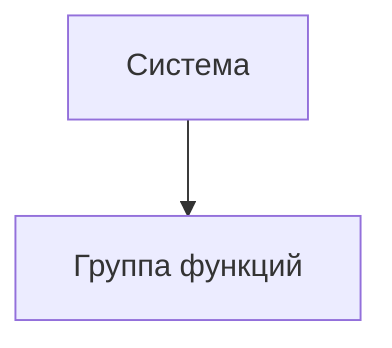

# Документ о концепции и границах кейса

| Поле | Значение |
|------|----------|
| Кейс | _название варианта_ |
| Индустриальный партнер | _организация / подразделение_ |
| Версия | `0.1-draft` |
| Дата | ГГГГ-ММ-ДД |
| Статус | черновик / на ревью / согласовано |
| Авторы | |

> [!NOTE]
> Заполняйте документ на языке заказчика. Образец глубины проработки — [`example/case_concept.md`](../example/case_concept.md). Колонки ID в таблицах шаблона — подсказка структуры, а не обязательная схема нумерации.

## 1. Введение

Краткая выжимка сути кейса: для кого система, какую проблему закрывает и чем отличается от текущего способа работы.

## 2. Бизнес-контекст и цели

### 2.1. Исходные данные

Как процесс устроен сейчас, какие потери времени / денег / качества наблюдаются, на каких фактах это основано.

### 2.2. Возможности бизнеса

Что изменится, если решение появится; какие смежные возможности откроются позже.

### 2.3. Бизнес-цели

| ID | Цель | Масштаб | Способ измерения | База | План | Обязательный порог | Срок |
|----|------|---------|------------------|------|------|--------------------|------|
| BO-1 | | | | | | | |
| BO-2 | | | | | | | |
| BO-3 | | | | | | | |

### 2.4. Видение решения

Одно-два предложения в формате: *для [пользователь], который [потребность], [имя системы] — это [тип продукта], который [ключевые возможности]. В отличие от [альтернатива], решение [отличие]*.

## 3. Стейкхолдеры

### 3.1. Профили заинтересованных лиц

| Заинтересованное лицо | Основная ценность | Отношение | Основные интересы | Ограничения |
|-----------------------|-------------------|-----------|-------------------|-------------|
| | | | | |

### 3.2. Матрица влияния / интереса

| Стейкхолдер | Влияние (низкое / среднее / высокое) | Интерес (низкий / средний / высокий) | Стратегия работы |
|-------------|--------------------------------------|--------------------------------------|------------------|
| | | | |

## 4. Функциональные требования

### 4.1. Основные функции

| ID | Функция | Краткое описание |
|----|---------|------------------|
| FE-1 | | |
| FE-2 | | |

### 4.2. Дерево функций

### 4.3. Пользовательские истории / варианты использования

| Основное действующее лицо | Варианты использования |
|---------------------------|------------------------|
| | |

### 4.4. Детальный сценарий (минимум один)

#### UC-1. _Название_

| Поле | Значение |
|------|----------|
| Автор / дата | |
| Основное действующее лицо | |
| Дополнительные действующие лица | |
| Описание | |
| Условие-триггер | |
| Предварительные условия | PRE-1. |
| Выходные условия | POST-1. |
| Приоритет | высокий / средний / низкий |
| Частота использования | |
| Бизнес-правила | BR-… |

**Нормальное направление**

1.
2.

**Альтернативные направления**

- 1.1 …

**Исключения**

- 1.0.E1 …

**Другая информация**

-

**Предположения**

-

### 4.5. Сжатые сценарии (по образцу Вигерса)

Остальные UC можно описать короче, если ключевая информация уже есть в другом источнике.

#### UC-n. _Название_

- Описание:
- Исключения:
- Приоритет:
- Бизнес-правила:
- Другая информация:

## 5. Нефункциональные требования

| ID | Категория | Требование | Метрика / порог |
|----|-----------|------------|-----------------|
| NFR-P1 | Производительность | | |
| NFR-A1 | Доступность | | |
| NFR-S1 | Безопасность | | |
| NFR-C1 | Совместимость / IT-ландшафт | | |
| NFR-U1 | Удобство использования | | |

## 6. Границы кейса

### 6.1. In Scope

- FE-1. Автоматический импорт готового расписания в формате JSON из корпоративной системы 1С:Университет ПРОФ.   
- FE-2. Оптимизация, очистка от дублирующихся записей разных служб и надежное хранение расписания во внутренней базе данных микросервиса Чат-бота MAX.
- FE-3. Выдача актуального расписания студентам и преподавателям по командам внутри мессенджера через Чат-бот MAX (MAX Bot).   
- FE-4. Автоматическая рассылка уведомлений пользователям в Чат-боте MAX при изменении расписания (отмены, переносы, смена аудитории или преподавателя).   
- FE-5. Разработка отдельного веб-сервиса Мини-приложения (MAX Mini App), который открывается внутри мессенджера MAX (через WebView) и доступен в веб-браузере, получая данные о расписании по API от микросервиса Чат-бота.
- FE-6. Формирование сводной аналитики и отчетов по загрузке аудиторий и преподавателей на основе хранимого расписания.

### 6.2. Out of Scope

- LI-1. Разработка автоматизированного рабочего места (АРМ) диспетчера и сеточного конструктора для ручного составления расписания (система импортирует уже сформированное расписание из внешних систем вуза).   
- LI-2. Первичный учет, ввод и редактирование справочников кадрового состава, контингента студентов, аудиторного фонда и учебных планов (ведутся во внешних системах вуза).   
- LI-3. Разработка нативных мобильных приложений под ОС iOS и Android для магазинов App Store и Google Play (клиентский доступ обеспечивается через Чат-бот MAX и веб-сервис Mini App).   
- LI-4. Учет посещаемости занятий, ведение электронных журналов успеваемости и выставление оценок.   
- LI-5. Автоматическая генерация сетки расписания с использованием алгоритмов искусственного интеллекта и нейросетей.

### 6.3. Состав первого и последующих выпусков

| Функция | Выпуск 1 | Выпуск 2 | Выпуск 3 |
|---------|----------|----------|----------|
| FE-1. Автоматический импорт из 1С | Автоматический импорт готового расписания (JSON) из 1С по расписанию (таймеру) в микросервис Чат-бота. | Мгновенное получение изменений расписания из 1С через входящие вебхуки. | Импорт расписания экзаменационной сессии и графика пересдач из смежных систем вуза. |
| FE-2. Оптимизация и хранение в БД бота | Очистка импортируемого расписания от дублей разных служб и сохранение в БД микросервиса бота с защитой от потери данных при сбоях. | Версионирование расписания и автоматическое выделение дельты изменений. | Хранение исторических архивов расписаний за прошлые семестры для аналитики. |
| FE-3. Выдача расписания в Чат-боте MAX | Работа внутри мессенджера MAX: выдача расписания на сегодня/завтра по кнопкам и командам; отдача данных по API для сервиса Mini App. | Поддержка поиска расписания по фамилии преподавателя и номеру аудитории прямо в чате бота. | Персональные подписки на несколько учебных групп или преподавателей одновременно. |
| FE-4. Уведомления об изменениях в боте | Информирование пользователя о времени последнего обновления расписания при запросе в чате. | Автоматическая рассылка адресных push-уведомлений студентам и преподавателям в Чат-боте MAX при переносах и отменах пар. | Настраиваемые напоминания за 15 минут до начала занятия с указанием корпуса и аудитории. |
| FE-5. Отдельный веб-сервис Mini App | Веб-приложение (работает во встроенном WebView мессенджера MAX и в браузере): обращение к API Чат-бота, просмотр расписания группы и преподавателя на неделю. | Фильтрация по типам занятий (лекция, практика, лабораторная), четности недель и поиск свободных аудиторий. | Наложение расписания внеучебных мероприятий вуза и экспорт в личный календарь. |
| FE-6. Отчетность и аналитика | Базовая сводка по импортированным записям и количеству устраненных дублей расписания. | Отчеты по фактической загрузке аудиторий (%) и преподавателей (часы) с выгрузкой в PDF. | Статистика пользовательской активности (число запросов в Чат-боте и просмотров в Mini App). |

## 7. Ограничения и допущения

### 7.1. Ограничения и исключения

См. ограничения LI-1 - LI-5 в подразделе 6.2. Out of Scope.

### 7.2. Предположения и зависимости

| ID | Тип | Формулировка |
|----|-----|--------------|
| AS-1 | допущение | Система 1С:Университет ПРОФ отдает готовое расписание в формате JSON со всеми необходимыми атрибутами (группа, дисциплина, преподаватель, аудитория, временной слот). |
| AS-2 | допущение | Микросервис Чат-бота имеет сетевой доступ к HTTP-сервису 1С для автоматического импорта и открыт для сетевых запросов со стороны отдельного веб-сервиса Mini App. |
| AS-3 | допущение | Все данные, передаваемые между 1С, микросервисом Чат-бота, платформой MAX и веб-сервисом Mini App, зашифрованы по протоколу HTTPS (TLS). |
| DE-1 | зависимость | Работа Чат-бота зависит от доступности платформы мессенджера MAX и получения авторизационного токена бота (Bearer Token). |
| DE-2 | зависимость | Автоматический импорт готового расписания зависит от доступности HTTP-сервиса 1С и предоставления учетных данных для авторизации со стороны ИТ-отдела вуза. |
| DE-3 | зависимость | Работа отдельного веб-сервиса Mini App напрямую зависит от доступности API микросервиса Чат-бота, который хранит в себе расписание и отдает его по запросу. |

### 7.3. Приоритеты проекта

| Область | Ограничения | Движущая сила | Степень свободы |
|---------|-------------|---------------|-----------------|
| Функции | Все функции Выпуска 1.0 (парсинг без ручного ввода, защита от слома, аудит авторизации, выгрузка через MAX Bridge API в Mini App и Chat Bot) должны быть полностью реализованы. | | |
| Качество | | 100% соблюдение правила BR-2 (блокировка пересечений); 100% гарантия отсутствия слома сетки при сбоях; 100% фиксация автора изменений в логах; полное соответствие контракту MAX Bridge API. | |
| Сроки | | | Релиз первого выпуска должен состояться за 2 недели до начала учебного семестра; допустимо смещение сроков не более чем на 7 календарных дней по согласованию с куратором. |
| Расходы | | | Бюджет фиксирован рамками студенческой разработки; превышение использования инфраструктурных мощностей вуза не более 10% без пересмотра куратором. |
| Персонал | | | Команда проекта: аналитик, 2 разработчика, инженер по интеграции/тестированию; при необходимости привлекается консультант ИТ-отдела вуза на 0,25 ставки. |

### 7.4. Особенности развертывания

Серверная часть приложения развертывается во внутреннем контуре университета на серверах под управлением Linux в изолированных Docker-контейнерах. Для работы интеграционного шлюза с платформой MAX необходимо настроить исходящее HTTPS-соединение через межсетевой экран вуза к шлюзу MAX Bridge API и применить сервисный Bearer-токен, полученный от digital.vuz@max.ru.   Все действия в системе защищены ролевой авторизацией: при входе диспетчера через единую учетную запись и при каждой публикации расписания в базу данных и журнал безопасности записывается уникальный идентификатор, ФИО и роль сотрудника, авторизовавшего операцию. Для диспетчеров учебного управления подготавливаются видеоинструкции (до 5 минут) и интерактивный тур по интерфейсу, обучающие запуску парсинга, разрешению конфликтов по правилу BR-2, проверке статуса публикации в MAX Mini App и отправке уведомлений через MAX Chat Bot.

## 8. Риски

| ID | Риск | Вероятность (0–1) | Ущерб (1–10) | Митигация |
|----|------|-------------------|--------------|-----------|
| RI-1 | Низкое качество исходных данных в 1С или обрыв выгрузки, грозящие поломкой существующей сетки расписания | 0,7 | 8 | Реализовать принцип «Гарантия: слома нет»: строгий шлюз предвалидации при парсинге, атомарные транзакции с полным откатом (Rollback) при ошибке и запрет физического удаления записей (soft delete), уже задействованных в сетке. |
| RI-2 | Изменения в контракте или временная недоступность шлюза MAX Bridge API | 0,3 | 8 | Вынести интеграцию с MAX Bridge API в изолированный модуль-адаптер; предусмотреть локальное сохранение версий расписания, очередь повторной отправки (retry) и резервный экспорт в .xlsx по шаблону MAX. |
| RI-3 | Превышение лимитов пропускной способности (Rate Limiting) шлюза MAX Bridge API при пакетной публикации | 0,5 | 6 | Реализовать пакетную отправку через асинхронную очередь с батчингом (дроблением на порции по 100–300 записей) и управляемыми задержками между запросами. |
| RI-4 | Несанкционированное изменение расписания или невозможность установить автора некорректной правки | 0,4 | 7 | Внедрить строгую ролевую авторизацию и неизменяемый журнал аудита (Audit Log), фиксирующий ФИО, ID сессии и точное время для каждого изменения ячейки или запуска публикации в MAX. |
| RI-5 | Рассинхронизация данных между MAX Mini App и MAX Chat Bot при лавинообразных правках в первую неделю семестра | 0,8 | 4 | Оптимизировать транзакции точечных обновлений; реализовать единую шину событий через MAX Bridge API и буферизацию (debounce) уведомлений перед отправкой в чат-бот. |
| RI-6 | Сопротивление диспетчеров: нежелание переходить с таблиц Excel на новый веб-интерфейс | 0,5 | 5 | Проектировать интерфейс по привычной ментальной модели сетки Excel с поддержкой горячих клавиш; провести очное обучение диспетчеров. |

> [!WARNING]
> Наибольший совокупный ущерб связан с качеством исходных данных (риск RI-1). Поскольку ключевой принцип заказчика исключает ручной ввод справочников, работоспособность конструктора напрямую зависит от валидности данных, переданных ИТ-отделом. Модуль импорта должен сразу отсекать некорректные записи с генерацией диагностического журнала.

## 9. Критерии приемки

| ID | Критерий | Как проверяется | Порог | Срок |
|----|----------|-----------------|-------|------|
| SM-1 | Сокращение срока парсинга, формирования и публикации чистового расписания на семестр | Хронометраж процесса учебного управления от старта парсинга нагрузки из 1С до публикации в MAX | Не более 7 рабочих дней | Приемка выпуска 1 |
| SM-2 | Полное исключение дублирующего ручного ввода справочных данных за счет автопарсинга | Аудит журнала создания сущностей в базе данных приложения | 100% справочников получены парсингом из 1С (0 сущностей, введенных вручную) | Приемка выпуска 1 |
| SM-3 | Отсутствие накладок в опубликованном расписании | Анализ сетки и проверка отчетов об инцидентах за первую учебную неделю | 0 накладок аудиторий, преподавателей и учебных групп | 1-я неделя семестра |
| SM-4 | Раздельный охват аудитории через MAX Mini App и MAX Chat Bot | Аналитика открытий мини-приложения и статистика активных подписчиков чат-бота вуза | Не менее 75% студентов и 60% преподавателей в Mini App; ≥90% успешной доставки уведомлений в Chat Bot | 1 месяц после релиза |
| SM-5 | Время формирования аналитического отчета по загрузке аудиторий и преподавателей | Замер времени генерации отчета в веб-интерфейсе | Менее 5 секунд на построение любого сводного отчета | Приемка выпуска 1 |
| AC-1 | Реализация функционального объема выпуска 1 (MVP) | Чек-лист проверки FE-1, FE-2, FE-3, FE-4, FE-5 | 100% запланированных сценариев выпуска 1 | Приемка выпуска 1 |
| AC-2 | Корректность интеграции через MAX Bridge API для обоих каналов (Mini App и Chat Bot) | Тестовая передача массивов расписания и триггеров уведомлений через шлюз MAX Bridge API | Код ответа HTTP 200/201 от MAX Bridge API; корректное отображение сетки в Mini App и доставка сообщения в Chat Bot | Приемка выпуска 1 |
| AC-3 | Гарантия целостности данных при сбоях парсинга и внешних систем | Нагрузочное и негативное тестирование: подача поврежденного JSON из 1С и принудительный обрыв связи с MAX Bridge API | 100% сохранение действующего расписания без потери пар | Приемка выпуска 1 |

Учебное управление принимает систему Выпуска 1, если в полном объеме выполнены критерии AC-1, AC-2, AC-3 и AC-4, подтверждающие работоспособность потокового парсинга, прозрачную фиксацию автора каждого действия, блокировку пересечений и бесшовную интеграцию через MAX Bridge API как для мини-приложения, так и для чат-бота. Метрики эффективности SM-1...SM-5 служат целевыми показателями (KPI) ввода системы в постоянную эксплуатацию и оцениваются по итогам первого семестрового цикла и реальной активности пользователей в экосистеме MAX.
